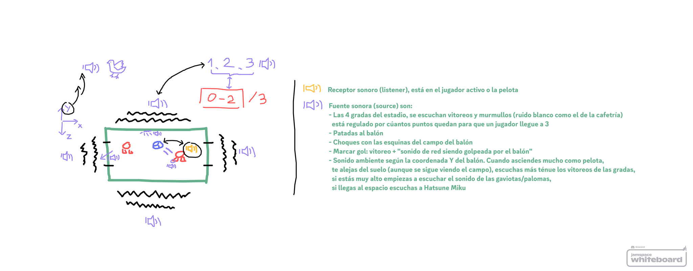

# Sonorización de partido de fútbol

## José Narciso Robles Durán & Izan de Vega López

## Resumen

Sonorizar un juego de fútbol *top-down* 1vs1 donde el oyente se encuentra especializado desde la pelota para experimentar con la idea de la integración (sensorial) intermodal (*Cross-Modal Binding*). Hecho en Unity con FMod, con parámetros dinámicos según la posición 3D de la pelota en un campo 2D.

## Componentes de la escena

- Balón: internamente 3D, visualmente aumenta de tamaño si es lanzado a mayor altura  
- 2 jugadores: uno por equipo, restringidos al movimiento *top-down* dentro del campo, producen ruido al correr por el campo, modulando las pisadas por su velocidad  
- 4 gradas: una en cada lado del campo, dónde se encuentran las principales fuentes sonoras. Sirven de barreras al game-play  
- 2 porterías: detectan gol, se intensifican los vitoreos de las gradas con este suceso y se aprecia un sonido de “balón chocando contra red”  
- Interfaz de puntos: muestra las puntuaciones, se intensifican los vitoreos de las gradas conforme la partida se acerca a su fin

## Objetivos de sonorización

### Gradas

Las 4 gradas laterales del escenario producen vitoreos, murmullos, ruido blanco, etc.  
El sonido de las gradas es dinámico y posicional según la cercanía del balón a las porterías.  
Las gradas plantean un desafío interesante en cuánto a la espacialización de cuatro fuentes, no puntuales, sino de área rectangular. Se considera optimizar las fuentes para conseguir una intensidad y localización sonora matemáticamente correcta, utilizando las mínimas fuentes posibles.  
Al marcar un gol se intensifican los vitoreos durante unos segundos antes de resetear la escena. Además se escuchará el ruido de la red modificado según la velocidad del balón.

### Balón

Bucle de césped si el balón está rodando y no en el aire. Al volver e impactar contra el suelo también hay una mezcla con varias muestras de impacto. Los jugadores golpean el balón mediante físicas de Unity y se escuchan las patadas al hacerlo.

Sonido ambiente según la altura del balón. Al alejarse del suelo se escuchan más leves los vitoreos. Al estar muy alto comienzas a escuchar pájaros. Y al subir más aún se pueden escuchar sonidos espaciales u otros sonidos distintos. El balón también produce sonidos al chocar contra las paredes del campo.  
Nuestra hipótesis de proyecto es: *el jugador será capaz de integrar mentalmente el fenómeno del ascenso del balón*, pese a la “perspectiva forzada” que tiene un juego *top-down*, *gracias a un efecto sonoro de FMod con la curva de variación adecuada* para percibir la disminución de los sonidos “cercanos al suelo” y el aumento de los “sonidos atmosféricos”, sumado al aumento visual del tamaño de la pelota.

## Interacción con el usuario

El usuario controla a ambos jugadores con el teclado. Con las teclas WASD se mueve el jugador del primer equipo y con las flechas direccionales al del segundo.

## Recursos

Entrevista más enfocada en grabación y obtener samples  
[https\://blog.soundparticles.com/how-paul-boechler-created-live-stadium-crowds-from-fifa-recordings](https://blog.soundparticles.com/how-paul-boechler-created-live-stadium-crowds-from-fifa-recordings)  
Sonido en unity en un juego real  
[https\://daracrawford.com/audio-blog/behind-the-scenes-creating-responsive-crowds-in-game-environments](https://daracrawford.com/audio-blog/behind-the-scenes-creating-responsive-crowds-in-game-environments)  
“Partículas” sonoras  
[https\://www\.asoundeffect.com/sound-particles-sound-design-tool/](https://www.asoundeffect.com/sound-particles-sound-design-tool/)

## Anexo

Se adjunta lo que es el boceto inicial del planteamiento de la escena y diversas fuentes sonoras ubicadas a modo de esquema.  

